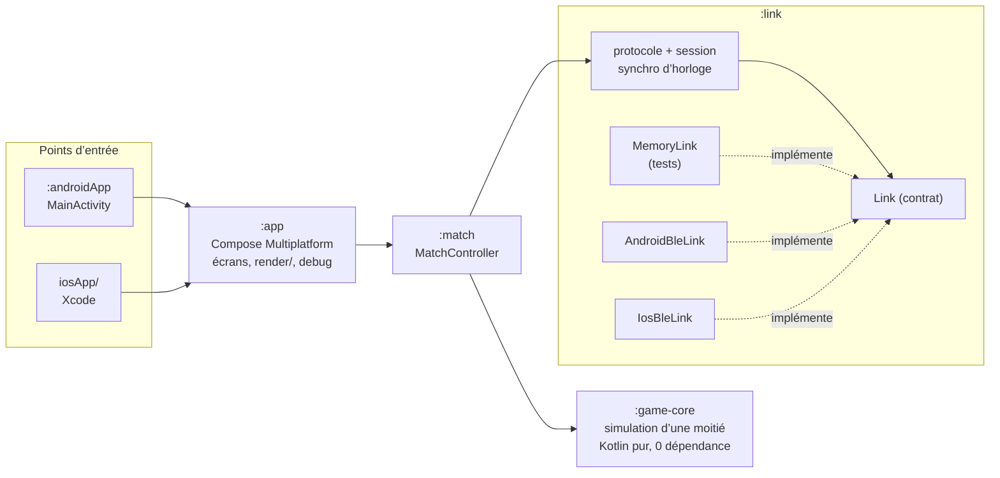

# Kysheon

Deux téléphones posés côte à côte forment une seule arène. Chaque écran est une moitié. Des formes géométriques
s’envoient des projectiles qui traversent la frontière d’un écran à l’autre. Les deux appareils sont reliés en
**Bluetooth Low Energy (GATT)**, sans internet.

Le jeu est un prétexte : le projet montre **Kotlin Multiplatform / Compose Multiplatform** sur Android et iOS,
le **BLE en rôle central et peripheral** sur les deux plateformes, une **synchronisation d’horloge** entre deux
appareils et un **protocole binaire** conçu et testé.

> Projet en cours (MVP V1). Ce README distingue ce qui est **vérifié** (tests automatisés, compilation) de ce qui
> **ne l’est pas encore** (tout ce qui exige les téléphones).

## État

| Élément | État | Vérifié par |
|---|---|---|
| Protocole binaire v1 (9 messages, ≤ 20 octets) | fait | tests octet par octet, JVM + Kotlin/Native |
| Synchronisation d’horloge, horloge de jeu lissée | fait | tests en temps virtuel |
| Session (HELLO, READY/START, heartbeat, pause, abandon, revanche) | fait | tests en temps virtuel |
| Simulation d’une moitié (pas fixe 60 Hz, collisions balayées, handoff) | fait | tests JVM + Kotlin/Native |
| Partie complète entre deux appareils simulés (50 ms + 20 ms de gigue) | fait | `FullMatchTest` |
| Lien BLE Android (host et guest) | en cours | — |
| Lien BLE iOS (guest, puis host) | en cours | — |
| Sonde de latence (écran de mesure) | en cours | — |
| Écrans de jeu, overlay de debug | à faire | — |
| **Fonctionnement sur appareil** | **non vérifié** | voir [`docs/MANUAL-TESTS.md`](docs/MANUAL-TESTS.md) |

## Principe

- **Host** = serveur GATT = moitié gauche. **Guest** = central = moitié droite.
- Chaque appareil simule **uniquement sa moitié**, à pas fixe 60 Hz, découplé du rendu.
- Un projectile qui sort d’une moitié est transmis (HANDOFF). **La moitié qui le reçoit décide de l’impact** et le
  notifie (HIT) : pas de simulation partagée, donc pas de désynchronisation possible.
- Espace logique normalisé : chaque moitié fait 1 de large ; la hauteur est le plus petit des deux ratios d’écran,
  avec des bandes à l’affichage si les écrans diffèrent.

## Architecture



`:game-core` ne connaît ni le BLE ni l’UI. Aucune API de plateforme dans le code commun : `expect`/`actual` ou
interface injectée. Le temps est toujours injecté (`MonotonicClock`), ce qui rend tout testable en temps virtuel.

| Module | Rôle |
|---|---|
| `:game-core` | Simulation d’une moitié : pas fixe, collisions balayées, entrée déterministe des projectiles. |
| `:link` | Contrat `Link`, protocole, synchro d’horloge, session, `MemoryLink`, BLE Android et iOS, sonde de latence. |
| `:match` | Relie la simulation et la session : HANDOFF, HIT, END. |
| `:app` | UI Compose Multiplatform. |
| `:androidApp`, `iosApp/` | Points d’entrée, sans logique. |

## Protocole

Binaire, big-endian, tailles fixes, un octet de code : HELLO, PING/PONG, READY, START, HANDOFF, HIT, END, HEARTBEAT.
Détails, valeurs en virgule fixe et déroulé d’une session : [`docs/PROTOCOL.md`](docs/PROTOCOL.md).
Synchronisation d’horloge : [`docs/CLOCK-SYNC.md`](docs/CLOCK-SYNC.md).

## Latences mesurées

Mesures faites avec l’écran « Sonde de latence », au moins 30 s, téléphones côte à côte.

| Liaison | Host → guest | RTT min | RTT médian | RTT p95 | Gigue | MTU |
|---|---|---|---|---|---|---|
| Nothing Phone (1) → CMF Phone 1 | Android → Android | non mesuré | non mesuré | non mesuré | non mesuré | non mesuré |
| CMF Phone 1 → Nothing Phone (1) | Android → Android | non mesuré | non mesuré | non mesuré | non mesuré | non mesuré |
| Android → iPhone 16e | Android → iOS | non mesuré | non mesuré | non mesuré | non mesuré | non mesuré |
| iPhone 16e → Android | iOS → Android | non mesuré | non mesuré | non mesuré | non mesuré | non mesuré |

## Construire et tester

Prérequis : JDK 21, Android SDK (plateforme 37), Xcode 26 pour iOS.

```bash
./gradlew jvmTest                                   # tests rapides : game-core, link, match
./gradlew iosSimulatorArm64Test                     # les mêmes tests en Kotlin/Native
./gradlew :androidApp:assembleDebug                 # APK de debug
./gradlew :app:linkDebugFrameworkIosArm64           # framework iOS pour appareil
```

## Dépendances

| Dépendance | Version | Pourquoi |
|---|---|---|
| Kotlin Multiplatform | 2.4.21 | Langage et cibles Android / iOS / JVM (tests). |
| Compose Multiplatform | 1.12.1 | UI commune Android + iOS, `Canvas` du jeu. |
| `components-resources` | 1.12.1 | Chaînes localisées EN / FR (`stringResource`). |
| kotlinx-coroutines (+ test) | 1.11.0 | `Flow`/`StateFlow` du contrat `Link` ; temps virtuel des tests. |
| lifecycle-viewmodel-compose (JetBrains) | 2.11.0 | La session BLE survit à la recréation de l’Activity. |
| androidx.activity-compose | 1.13.0 | `setContent`, demande de permissions Android. |

Le protocole, la synchronisation et `:game-core` n’ont **aucune** dépendance. Pas de bibliothèque BLE tierce :
le rôle peripheral est requis et la couche BLE est écrite depuis la documentation officielle.
Versions et compatibilités : [KYS-0004](docs/decisions/0004-toolchain-versions.md).

## Limites connues

- Rien n’a encore été vérifié sur téléphone.
- Le simulateur iOS n’a pas de Bluetooth : tout test iOS se fait sur un iPhone réel.
- iOS ne permet pas de régler l’intervalle de connexion BLE ; il sera mesuré et documenté.
- Pas de reconnexion automatique en V1 : une perte de lien ramène à l’accueil.
- Jeu au premier plan uniquement.

## Décisions

Les choix d’architecture et les contournements sont consignés dans [`docs/decisions/`](docs/decisions/README.md).

## Licences

- Code : [MIT](LICENSE), © 2026 LyphosSyss.
- Assets : CC0 uniquement, listés dans [`ASSETS.md`](ASSETS.md). La V1 n’embarque aucun asset externe.
- Le principe (une arène partagée entre deux écrans) s’inspire d’un jeu existant ; aucun nom, visuel, son ni asset
  de ce jeu ou d’une autre licence n’est repris.
