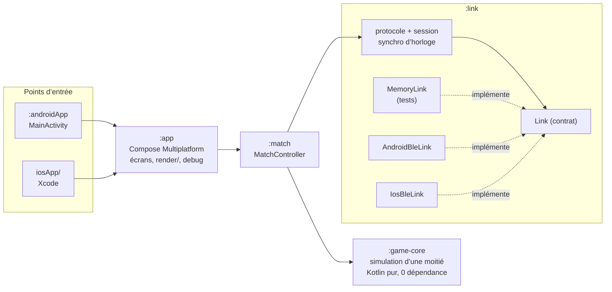

# Kysheon

[](https://github.com/LyphosSyss/kysheon/actions/workflows/ci.yml)

Deux téléphones posés côte à côte forment une seule arène. Chaque écran est une moitié. Des formes géométriques
s’envoient des projectiles qui traversent la frontière d’un écran à l’autre. Les deux appareils sont reliés en
**Bluetooth Low Energy (GATT)**, sans internet.

Le jeu est un prétexte : le projet montre **Kotlin Multiplatform / Compose Multiplatform** sur Android et iOS,
le **BLE en rôle central et peripheral** sur les deux plateformes, une **synchronisation d’horloge** entre deux
appareils et un **protocole binaire** conçu et testé.

> Projet en cours (MVP V1). Ce README distingue ce qui est **vérifié** (tests automatisés, compilation) de ce qui
> **ne l’est pas encore** (tout ce qui exige les téléphones).

## État

| Élément | État | Vérifié par |
|---|---|---|
| Protocole binaire v1 (9 messages, ≤ 20 octets) | fait | tests octet par octet, JVM + Kotlin/Native |
| Synchronisation d’horloge, horloge de jeu lissée | fait | tests en temps virtuel |
| Session (HELLO, READY/START, heartbeat, pause, abandon, revanche) | fait | tests en temps virtuel |
| Simulation d’une moitié (pas fixe 60 Hz, collisions balayées, handoff) | fait | tests JVM + Kotlin/Native |
| Partie complète entre deux appareils simulés (50 ms + 20 ms de gigue) | fait | `FullMatchTest` |
| Lien BLE Android (host et guest) | fait | **vérifié sur téléphones** (Nothing Phone (1) ↔ CMF Phone 1, les deux sens), 2026-10-09 |
| Lien BLE iOS (guest et host) | fait | **vérifié sur iPhone 16e** (iOS 27.0) avec le Nothing Phone (1), les deux rôles, sonde uniquement |
| Sonde de latence (écran de mesure) | fait | tests en temps virtuel ; mesures réelles ci-dessous |
| Écrans de jeu, overlay de debug | fait | partie complète et revanche jouées sur les deux Android ; build Xcode + simulateur iOS (accueil) |
| Android ↔ iOS (sonde dans les deux sens, partie, coupure Bluetooth côté iPhone) | fait | **vérifié sur téléphones** (iPhone 16e ↔ Nothing Phone (1)) |
| Coupure Bluetooth en pleine partie (côté invité) | fait | **vérifié sur téléphones** : retour à l’accueil avec message des deux côtés, aucun crash |
| Coupure côté hôte, hors de portée, arrière-plan | **non vérifié** | voir [`docs/MANUAL-TESTS.md`](docs/MANUAL-TESTS.md) |

## Principe

- **Host** = serveur GATT = moitié gauche. **Guest** = central = moitié droite.
- Chaque appareil simule **uniquement sa moitié**, à pas fixe 60 Hz, découplé du rendu.
- Un projectile qui sort d’une moitié est transmis (HANDOFF). **La moitié qui le reçoit décide de l’impact** et le
  notifie (HIT) : pas de simulation partagée, donc pas de désynchronisation possible.
- Espace logique normalisé : chaque moitié fait 1 de large ; la hauteur est le plus petit des deux ratios d’écran,
  avec des bandes à l’affichage si les écrans diffèrent.

## Architecture



`:game-core` ne connaît ni le BLE ni l’UI. Aucune API de plateforme dans le code commun : `expect`/`actual` ou
interface injectée. Le temps est toujours injecté (`MonotonicClock`), ce qui rend tout testable en temps virtuel.

| Module | Rôle |
|---|---|
| `:game-core` | Simulation d’une moitié : pas fixe, collisions balayées, entrée déterministe des projectiles. |
| `:link` | Contrat `Link`, protocole, synchro d’horloge, session, `MemoryLink`, BLE Android et iOS, sonde de latence. |
| `:match` | Relie la simulation et la session : HANDOFF, HIT, END. |
| `:app` | UI Compose Multiplatform. |
| `:androidApp`, `iosApp/` | Points d’entrée, sans logique. |

## Protocole

Binaire, big-endian, tailles fixes, un octet de code : HELLO, PING/PONG, READY, START, HANDOFF, HIT, END, HEARTBEAT.
Détails, valeurs en virgule fixe et déroulé d’une session : [`docs/PROTOCOL.md`](docs/PROTOCOL.md).
Synchronisation d’horloge : [`docs/CLOCK-SYNC.md`](docs/CLOCK-SYNC.md).

## Latences mesurées

Mesures réelles du 2026-10-09 avec l’écran « Sonde de latence » (PING toutes les 100 ms, fenêtre de 300 échantillons),
téléphones côte à côte. Le RTT est mesuré par chaque téléphone sur ses propres PING ; le décalage est
`horloge du pair − horloge locale`, avec sa borne d’erreur (RTT min de la dernière rafale / 2).

| Liaison (host → guest) | Mesuré sur | Durée | RTT min | RTT médian | RTT p95 | RTT max | Gigue | Pertes | MTU |
|---|---|---|---|---|---|---|---|---|---|
| Nothing Phone (1) → CMF Phone 1 | host (Nothing) | 271 s | 19,0 ms | 34,8 ms | 51,8 ms | 89,0 ms | 10,1 ms | 0 | 517 |
| Nothing Phone (1) → CMF Phone 1 | guest (CMF) | 248 s | 21,5 ms | 41,5 ms | 60,0 ms | 115,1 ms | 10,4 ms | 0 | 517 |
| CMF Phone 1 → Nothing Phone (1) | host (CMF) | 43 s | 20,4 ms | 33,5 ms | 49,7 ms | 61,9 ms | 9,9 ms | 0 | 517 |
| CMF Phone 1 → Nothing Phone (1) | guest (Nothing) | 42 s | 19,3 ms | 34,5 ms | 44,7 ms | 57,9 ms | 6,7 ms | 0 | 517 |
| Nothing Phone (1) → iPhone 16e | host (Nothing) | 13 s | 37,2 ms | 54,6 ms | 70,6 ms | 94,2 ms | 15,8 ms | 0 | 517 |
| Nothing Phone (1) → iPhone 16e | guest (iPhone) | 67 s | 37,6 ms | 54,9 ms | 69,8 ms | 128,3 ms | 16,3 ms | 0 | 515 ¹ |
| iPhone 16e → Nothing Phone (1) | guest (Nothing) | 92 s | 22,1 ms | 32,4 ms | 43,4 ms | 50,8 ms | 7,0 ms | 0 | 517 |
| iPhone 16e → Nothing Phone (1) | host (iPhone) | 40 s | 23,0 ms | 35,6 ms | 49,0 ms | 68,0 ms | 7,5 ms | 0 | 515 ¹ |

¹ iOS n’expose pas la MTU : la valeur affichée est la charge utile maximale annoncée (512 octets) + 3.

Quand l’iPhone est central (invité), c’est iOS qui choisit l’intervalle de connexion, sans réglage possible : la
latence y est la plus élevée (médiane ≈ 55 ms). Quand l’Android est central, il demande la priorité haute et le RTT
médian tombe à ≈ 32 ms, même avec l’iPhone en peripheral.

Observé dans les journaux système : intervalle de connexion 15 ms (12 × 1,25 ms, brièvement 7,5 ms), PHY LE 2M.
Décalage d’horloge mesuré de part et d’autre : +122,5 ± 9,6 ms et −127,1 ± 10,8 ms, cohérents entre eux.
La dérive affichée par la sonde n’est **pas encore exploitable** : avec ± 10 ms d’incertitude sur le décalage,
quelques minutes ne suffisent pas à estimer quelques ppm (valeurs observées de signes contradictoires).

**Conséquence pour le jeu** : environ 17–25 ms par trajet en médiane, bien en dessous du rattrapage maximal de
200 ms appliqué à un projectile qui change d’écran. Le design du handoff est conservé tel quel.

## Construire et tester

Prérequis : JDK 21, Android SDK (plateforme 37), Xcode 26 pour iOS.

```bash
./gradlew jvmTest                                   # tests rapides : game-core, link, match
./gradlew iosSimulatorArm64Test                     # les mêmes tests en Kotlin/Native
./gradlew :androidApp:assembleDebug                 # APK de debug
./gradlew :app:linkDebugFrameworkIosArm64           # framework iOS pour appareil
```

## Intégration continue

[`.github/workflows/ci.yml`](.github/workflows/ci.yml), à chaque push sur `main` et à chaque pull request, sans aucun secret :

| Job | Runner | Étapes |
|---|---|---|
| JVM tests and Android build | `ubuntu-latest` | validation du wrapper Gradle, `jvmTest` (game-core, link, match), APK de debug, lint Android |
| Kotlin/Native tests and iOS build | `macos-26` (Xcode 26.6) | mêmes tests sur le simulateur iOS, framework iOS appareil, build Xcode du simulateur sans signature |

Les actions tierces sont épinglées par SHA de commit. Premier passage sur GitHub le 2026-10-09 : les deux jobs verts
(Linux en 4 min environ, macOS en 10 min environ).

## Dépendances

| Dépendance | Version | Pourquoi |
|---|---|---|
| Kotlin Multiplatform | 2.4.21 | Langage et cibles Android / iOS / JVM (tests). |
| Compose Multiplatform | 1.12.1 | UI commune Android + iOS, `Canvas` du jeu. |
| `components-resources` | 1.12.1 | Chaînes localisées EN / FR (`stringResource`). |
| kotlinx-coroutines (+ test) | 1.11.0 | `Flow`/`StateFlow` du contrat `Link` ; temps virtuel des tests. |
| lifecycle-viewmodel-compose (JetBrains) | 2.11.0 | La session BLE survit à la recréation de l’Activity. |
| androidx.activity-compose | 1.13.0 | `setContent`, demande de permissions Android. |

Le protocole, la synchronisation et `:game-core` n’ont **aucune** dépendance. Pas de bibliothèque BLE tierce :
le rôle peripheral est requis et la couche BLE est écrite depuis la documentation officielle.
Versions et compatibilités : [KYS-0004](docs/decisions/0004-toolchain-versions.md).

## Limites connues

- Vérifié sur téléphones : Android ↔ Android (sonde, jeu, revanche, coupure Bluetooth) et Android ↔ iOS (sonde dans
  les deux sens, partie avec l’iPhone hôte, coupure Bluetooth côté iPhone). Pas encore : coupure côté hôte Android,
  hors de portée, arrière-plan, CMF Phone 1 ↔ iPhone.
- La dérive d’horloge affichée par la sonde n’est pas fiable sur quelques minutes.
- Le simulateur iOS n’a pas de Bluetooth : tout test iOS se fait sur un iPhone réel.
- iOS ne permet pas de régler l’intervalle de connexion BLE ; il sera mesuré et documenté.
- Pas de reconnexion automatique en V1 : une perte de lien ramène à l’accueil.
- Jeu au premier plan uniquement.

## Décisions

Les choix d’architecture et les contournements sont consignés dans [`docs/decisions/`](docs/decisions/README.md).

## Licences

- Code : [MIT](LICENSE), © 2026 LyphosSyss.
- Assets : CC0 uniquement, listés dans [`ASSETS.md`](ASSETS.md). La V1 n’embarque aucun asset externe.
- Le principe (une arène partagée entre deux écrans) s’inspire d’un jeu existant ; aucun nom, visuel, son ni asset
  de ce jeu ou d’une autre licence n’est repris.
