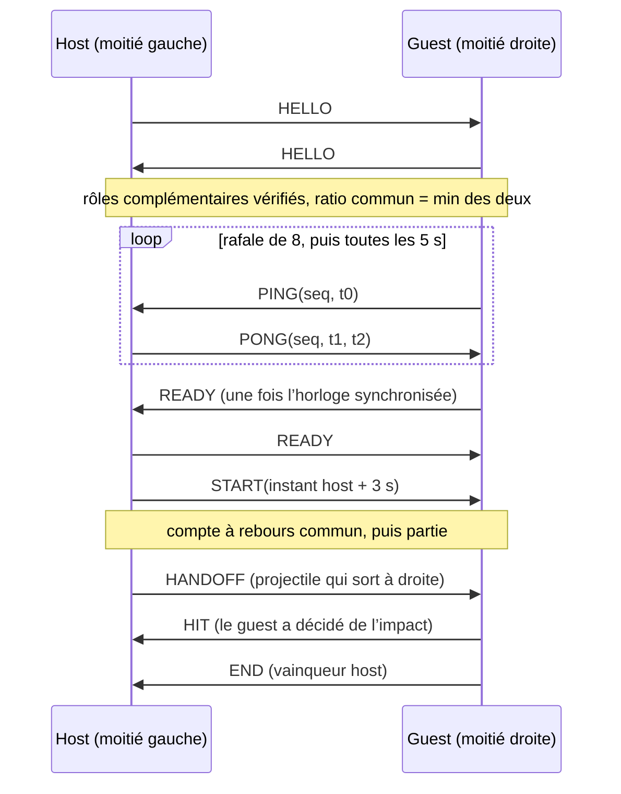

# Protocole Kysheon v1

Binaire, big-endian, tailles fixes, un octet de code en tête. Source : [`Message.kt`](../link/src/commonMain/kotlin/epheis/lyphossyss/kysheon/link/protocol/Message.kt),
[`MessageCodec.kt`](../link/src/commonMain/kotlin/epheis/lyphossyss/kysheon/link/protocol/MessageCodec.kt).

**Toute trame tient en 20 octets** (MTU ATT par défaut 23 − 3) : le protocole fonctionne même si la négociation
de MTU échoue. Voir [KYS-0002](decisions/0002-frames-20-bytes.md).

## Trames

| Code | Message | Contenu après le code | Total |
|---|---|---|---|
| 1 | HELLO | version u8 · rôle u8 (0 host, 1 guest) · ratio hauteur/largeur × 1000 u16 | 5 |
| 2 | PING | kind u8 = 0 · seq u8 · t0 i64 | 11 |
| 2 | PONG | kind u8 = 1 · seq u8 · t1 i64 · t2 i64 | 19 |
| 3 | READY | — | 1 |
| 4 | START | instant i64 | 9 |
| 5 | HANDOFF | id u16 · y u16 · vx i16 · vy i16 · instant de sortie i64 | 17 |
| 6 | HIT | id u16 · instant i64 | 11 |
| 7 | END | vainqueur u8 · raison u8 (0 K.-O., 1 abandon) | 3 |
| 8 | HEARTBEAT | seq u8 | 2 |

## Temps

- Microsecondes d’une horloge **monotone** (jamais l’heure murale), origine arbitraire propre à chaque appareil.
- PING/PONG portent l’horloge de leur émetteur (`t0`, puis `t1`/`t2` côté répondeur). PONG ne renvoie pas `t0` :
  l’émetteur le retrouve par `seq`.
- Tous les autres instants (START, HANDOFF, HIT) sont exprimés sur **l’horloge du host**. Le guest la reconstruit
  par la synchronisation ([CLOCK-SYNC.md](CLOCK-SYNC.md)).

## Valeurs en virgule fixe (HANDOFF, HELLO)

| Champ | Codage | Résolution / bornes |
|---|---|---|
| `y` | `round(y × 65535)`, y normalisé dans [0, 1] | 1,5 × 10⁻⁵ de la hauteur |
| `vx`, `vy` | `round(v × 1000)`, en largeurs de moitié par seconde | ± 32,767 largeurs/s |
| ratio | `round(hauteur / largeur × 1000)` | 0,001 à 65,535 |

Le décodage est exact : `decode(encode(m)) == m`, vérifié octet par octet dans `MessageCodecTest`.

## Versionnage

Les deux premiers octets de HELLO (`[1][version]`) ne changeront jamais. Le décodeur signale
`IncompatibleVersion` **avant** de vérifier la longueur, ce qui permet de refuser proprement un pair d’une autre version,
quelle que soit la taille de son HELLO. La session s’arrête alors avec `AbortReason.IncompatibleVersion` et l’UI l’affiche.

## Déroulé d’une session

## Règles de session

- **Heartbeat** chaque seconde dans les deux sens. Toute trame valide prouve que le pair est vivant.
- **3 s sans trame** : pause. **5 s de plus** : abandon (`PeerSilent`). Au retour des trames, le host renvoie un START
  (reprise commune 1 s plus tard) ; un guest qui revient envoie READY, que le host traite comme une demande de reprise.
- **Perte de lien** (`LinkState.Lost`) : abandon immédiat.
- **Décision d’impact** : la moitié qui reçoit le projectile décide seule (pas de simulation partagée, donc pas de
  désynchronisation). Elle envoie HIT, et END si son combattant tombe.
- **K.-O. simultanés** : chaque moitié peut annoncer sa propre défaite pendant que l’END de l’autre est en vol.
  Deux annonces opposées donnent une égalité, calculée de la même façon des deux côtés.
- **Revanche** : après END, READY des deux côtés relance un START.
